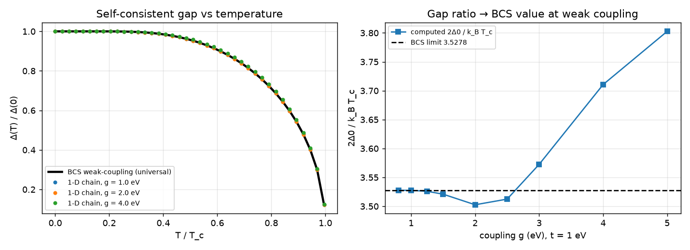
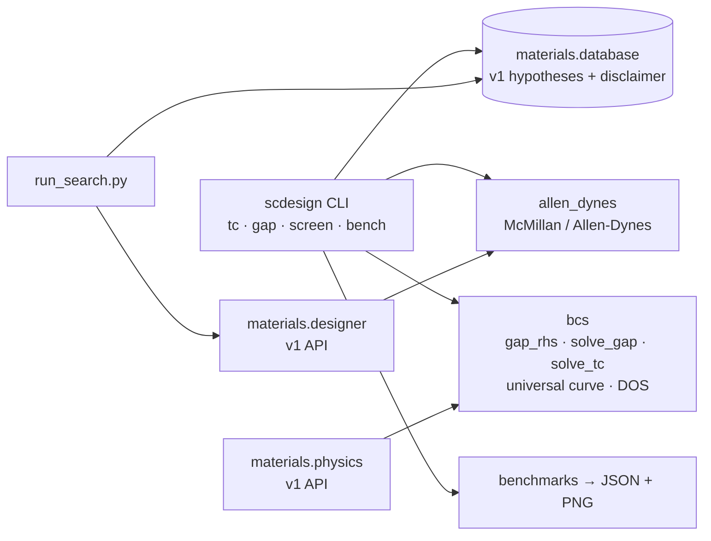

# scdesign: superconducting T_c formulas and a BCS gap solver, validated against known limits

[](https://github.com/Cyb0rg137ms/Superconductor-Design-Engine-Materials-Screening/actions/workflows/ci.yml)

[](LICENSE)

This repo has a vectorised McMillan / Allen-Dynes T_c calculator and a mean-field BCS gap solver on a 1-D chain. Both are checked against textbook limits. It also includes a small screening demo over **hypothetical** candidate compounds, and those are clearly labelled as such.



*Left: the self-consistent gap Δ(T)/Δ(0) of the chain for g = 1, 2, 4 eV lies on the universal weak-coupling BCS curve. Right: 2Δ0/k_BT_c goes to the BCS value 2π/e^γ = 3.528 as g → 0. Generated by `scdesign bench` (data in [`docs/assets/bench.json`](docs/assets/bench.json)).*

## Why it matters

T_c estimates from λ, ω_log and μ* often go into screening pipelines. A wrong constant in the Allen-Dynes correction factors goes unnoticed because the output still "looks plausible". v1 of this repo had exactly that bug: Λ1 = 1.01(1+2μ*) and Λ2 = 1.61(1+2μ*) instead of 2.46(1+3.8μ*) and 1.82(1+6.3μ*)·(ω̄2/ω_log). On its own inputs, v1 overestimated T_c by 18–42 %. Its benchmark table also listed values that its own code did not produce. v2 replaces the formulas, tests them against closed forms and physical limits, and keeps the v1 API working.

## Key results (measured; reproduce with `scdesign bench`)

**BCS gap ratio vs coupling** (1-D chain, t = 1 eV, μ = 0, n_k = 40 000):

| g (eV) | Δ0 (eV) | T_c (model K) | 2Δ0 / k_BT_c |
|---|---|---|---|
| 0.8 | 0.00311 | 20.43 | 3.5277 |
| 1.0 | 0.01494 | 98.29 | 3.5275 |
| 1.5 | 0.12096 | 797.36 | 3.5209 |
| 2.0 | 0.34043 | 2255.75 | 3.5026 |
| 3.0 | 0.93092 | 6047.70 | 3.5725 |
| 5.0 | 2.11834 | 12929.09 | 3.8026 |
| BCS limit | | | 3.5278 |

The weak-coupling ratio matches BCS to 4 significant figures. The g values are model units, not real materials (see [Limitations](#limitations-and-roadmap)).

**Allen-Dynes on v1's own inputs** (μ* = 0.13, ω̄2/ω_log = 1.2). The λ and ω_log inputs come from v1 and are unsourced; the experimental T_c values are the commonly quoted ones:

| Material | λ | ω_log (K) | v1 README claimed | v1 code actually gives | McMillan | **Allen-Dynes (v2)** | Experiment |
|---|---|---|---|---|---|---|---|
| Pb | 1.55 | 58 | 7.1 | 8.89 | 6.24 | **6.94** | 7.2 |
| Nb | 1.04 | 163 | 9.3 | 13.05 | 10.42 | **11.06** | 9.25 |
| H3S (150 GPa) | 2.20 | 1100 | 191 | 259.89 | 157.97 | **187.75** | 203 |
| LaH10 (170 GPa) | 2.50 | 1250 | 242 | 338.58 | 194.42 | **238.32** | ~250 |

**Speed** (median of 3; `gap_rhs` NumPy vs the v1 Python loop, 8-vCPU Linux box, Python 3.13):

| n_k | v1 loop | NumPy | solve_gap (bisection) | solve_tc |
|---|---|---|---|---|
| 500 | 0.14 ms | 0.022 ms | 0.66 ms | 0.60 ms |
| 5000 | 1.09 ms | 0.076 ms | 3.04 ms | 2.24 ms |

```bash
pip install -e ".[dev]"
scdesign bench                  # full run, writes docs/assets/bench.json + bcs_validation.png (~6 s)
scdesign bench --quick --out /tmp/b   # CI smoke run
```

## Architecture



More detail is in [docs/ARCHITECTURE.md](docs/ARCHITECTURE.md).

## 60-second quickstart

```bash
git clone https://github.com/Cyb0rg137ms/Superconductor-Design-Engine-Materials-Screening
cd Superconductor-Design-Engine-Materials-Screening
pip install -e ".[dev]"
scdesign tc --lam 1.55 --omega-log 58 --mu 0.13    # Pb-like inputs → Allen-Dynes 6.76 K (ω̄2/ω_log = 1)
scdesign gap --g 1.0 --n-k 20000                   # Δ0, T_c, 2Δ0/kT_c ≈ 3.528
pytest -q
```

Docker: `docker build -t scdesign . && docker run --rm scdesign`

## Usage

```python
import numpy as np
from scdesign import Chain, allen_dynes_tc, mcmillan_tc, solve_gap, solve_tc

allen_dynes_tc(1100.0, np.array([1.5, 2.0, 2.5]), 0.13, 1.2)  # vectorised over λ
chain = Chain(hopping_t=1.0, mu=0.0, coupling_g=2.0, n_k=20000)
solve_gap(chain, temperature=300.0), solve_tc(chain)
```

* `scdesign screen --max-pressure 10 --min-tc 270` prints the v1 candidate list along with its disclaimer.
* `python run_search.py` runs the original v1 pipeline. It now prints the disclaimer and labels its numbers as hypothesised or heuristic.
* `python examples/compare_formulas.py` gives a McMillan vs Allen-Dynes λ sweep and one chain solve.
* The v1 API is unchanged: `materials.designer.calculate_allen_dynes_tc` and `materials.physics.solve_gap_self_consistent` keep their signatures and delegate to the corrected code.

## Design decisions and trade-offs

* **Bisection instead of fixed-point iteration.** `gap_rhs` is monotone in Δ, so bisection always converges and cannot report a false convergence. It costs about 50 evaluations; each is a NumPy reduction, so that is cheap.
* **The v1 formula is kept as `_v1_allen_dynes` only inside the benchmark**, so the error it made is reproducible rather than asserted.
* **Default ω̄2/ω_log = 1.0 in the new API** (f2 = 1, the conservative choice). The v1-compatible `materials` function keeps v1's 1.2.
* **The v1 docs are kept, not deleted.** They are in `docs/*_v1.md`, and the v1 benchmark file is renamed `BENCHMARK_RESULTS_v1_unreproducible.md`.
* **The v1 candidate data is kept** for compatibility (tests and `run_search.py` still use it), but every entry gets a `status` field and the module exports a `DISCLAIMER`.

## Limitations and roadmap

* Nothing here predicts new superconductors. λ, ω_log and μ* are inputs and are never computed from structure.
* The candidate database (CaH12 at 8 GPa, C6Li, metallic H at ambient pressure, …) consists of **unverified hypotheses with invented confidence scores**, inherited from v1.
* `evaluate_clathrate` is a toy scaling heuristic.
* The 1-D chain uses band-wide coupling, so its gaps and T_c are in model units. Weak couplings below the k-grid resolution return Δ = 0.
* Roadmap: α²F(ω) input, an isotropic Eliashberg cross-check, and 2-D/3-D lattices. Full list in [docs/LIMITATIONS.md](docs/LIMITATIONS.md).

## Citation

```bibtex
@software{scdesign2026,
  author = {Cyb0rg137ms},
  title  = {scdesign: validated McMillan/Allen-Dynes T_c formulas and a mean-field BCS gap solver},
  year   = {2026},
  url    = {https://github.com/Cyb0rg137ms/Superconductor-Design-Engine-Materials-Screening}
}
```

The formulas come from W. L. McMillan, *Phys. Rev.* 167, 331 (1968) and P. B. Allen & R. C. Dynes, *Phys. Rev. B* 12, 905 (1975).

## License

MIT. See [LICENSE](LICENSE).
