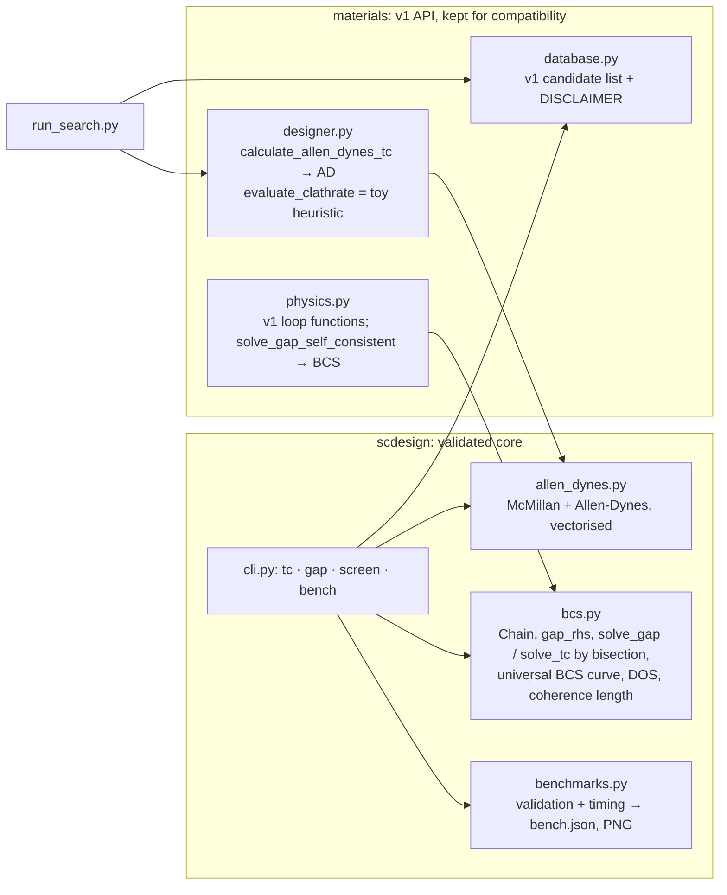

# Architecture (v2)

* **Gap equation.** `gap_rhs(chain, Δ, T) = (g/N) Σ_k tanh(E_k/2k_BT)/(2E_k)` is strictly decreasing
  in Δ, so the root of `gap_rhs = 1` is bracketed and found by bisection: guaranteed convergence, no
  mixing parameter, no false "converged" states (v1's fixed-point loop declared convergence at
  Δ ≈ 6·10⁻⁶ for g = 0.5 because its tolerance was absolute).
* **T_c** is the root of `gap_rhs(Δ→0, T) = 1`, also by bisection on a log-T bracket.
* **Universal curve** `bcs_universal_gap(T/T_c)` solves the weak-coupling BCS equation in reduced
  units on a logarithmic ξ grid with the analytic `asinh` contribution of `[0, x0]`, used as the
  reference in the validation plot.
